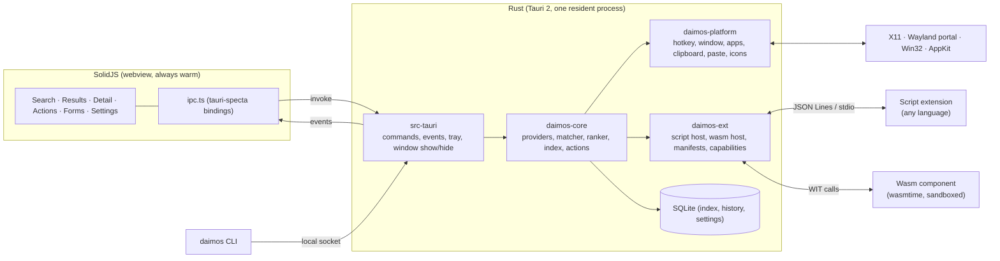

# Architecture

Three layers: SolidJS renders, Rust indexes, matches, and talks to the OS, SQLite stores. The core
crate (`daimos-core`) does not know about Tauri, so it can run headless (CLI, benchmarks, CI).
The platform crate hides the three operating systems behind one trait per concern.

## Process model

One resident process. It registers the hotkey, creates the window once at start-up, and from then
on only hides and shows it. A hidden window keeps the webview, the Solid component tree, and the
last result list warm, which is what makes the 50 ms budget reachable. Closing the window means
hiding it; quitting happens from the tray or the CLI.

A thin `daimos` CLI talks to the process over a local socket (Unix socket on Linux and macOS,
named pipe on Windows): `daimos toggle`, `daimos show "query"`, `daimos ext install`,
`daimos ext dev <path>`. On Wayland compositors without the GlobalShortcuts portal, the user binds
`daimos toggle` in the compositor configuration.

## Rust workspace

| Crate                      | Responsibility                                                                                                                                                     |
| -------------------------- | ------------------------------------------------------------------------------------------------------------------------------------------------------------------ |
| `crates/daimos-core`     | Domain without Tauri: `Provider` trait, query pipeline, fuzzy matcher (`nucleo-matcher`), frecency ranker, index, actions, settings. Tested and benchmarked with `cargo` |
| `crates/daimos-platform` | OS integration behind traits: `Hotkey`, `WindowHost`, `AppSource`, `Clipboard`, `Paster`, `IconLoader`, `WindowList`. One module per platform, selected with `cfg` |
| `crates/daimos-ext`      | Extension host: manifest parsing, script host (JSON Lines over stdio), wasm host (wasmtime + component model), capability checks                                   |
| `crates/daimos-cli`      | The `daimos` binary: socket client, extension scaffolding                                                                                                        |
| `src-tauri`                | Thin layer: commands, events, tray, window lifecycle, plugins                                                                                                      |

## Query pipeline

1. The webview sends every keystroke as `query(text, session_id)`; the core cancels the previous
   query for that session.
2. The core fans the query out to the active providers (apps, calculator, files, extensions, …).
   Each provider returns items with a score or a "not applicable" within its own budget; built-in
   providers run in-process, extension providers run in the extension host with a timeout.
3. The matcher scores items with `nucleo-matcher` (the matcher behind the Helix editor); the ranker
   blends match score, frecency (how often and how recently an item was chosen), and provider
   weight.
4. Results stream back as events, so a slow extension never delays apps or the calculator. The UI
   renders the first batch in the same frame and merges later batches in place.

## Data model

The data model is shared by built-in providers, script extensions, and wasm extensions, and is
deliberately close to Raycast's so ports are mechanical.

- **Item**: `id`, `title`, `subtitle`, `icon` (named, file, or data URL), `keywords`, `accessories`,
  `actions`, optional `detail` (Markdown or key/value metadata).
- **Action**: `id`, `title`, `shortcut`, `kind` (`open`, `copy`, `paste`, `run`, `push`, `form`),
  payload. `paste` targets the window that was active before the daimos opened.
- **View**: a provider can respond with a `list` (the default), a `detail`, a `form` (fields with
  validation), or `push` another view onto the navigation stack. Views are data; the webview renders
  them.

## Platform layer

| Concern            | Linux X11                 | Linux Wayland                                                         | Windows                                                        | macOS                                                   |
| ------------------ | ------------------------- | --------------------------------------------------------------------- | -------------------------------------------------------------- | ------------------------------------------------------- |
| Global hotkey      | `global-hotkey` (XGrabKey) | XDG `GlobalShortcuts` portal via `ashpd`; fallback `daimos toggle` | `RegisterHotKey`                                               | `tauri-plugin-global-shortcut` (Carbon/CGEvent)         |
| Window kind        | Override-redirect toplevel | `gtk-layer-shell` overlay where supported; toplevel on GNOME          | `WS_EX_TOOLWINDOW`, no taskbar entry; foreground after hotkey   | `NSPanel`, non-activating, joins all Spaces (`tauri-nspanel`) |
| App index          | `.desktop` entries, icon theme lookup | same                                                      | Start Menu `.lnk`, `shell:AppsFolder` for packaged apps, icons via `IShellItemImageFactory` | `.app` bundles in standard folders, icons via `NSWorkspace` |
| Clipboard          | `arboard` + polling       | `wl-clipboard-rs` (`wlr-data-control`)                                | `AddClipboardFormatListener`                                   | `changeCount` polling                                   |
| Paste into previous window | XTest             | `wtype`/`ydotool` where available, else copy only                      | `SendInput`                                                    | `CGEvent` (needs Accessibility permission)              |
| Autostart          | `tauri-plugin-autostart` (XDG autostart) | same                                                   | same (registry Run key)                                        | same (Login Items)                                      |

Everything the table lists as "where supported" degrades explicitly: the capability is reported to
the UI and the settings page says what is missing and why.

## Persistence

SQLite via `rusqlite` (bundled, synchronous, FTS5) in the user data directory: app index, file
index, frecency, clipboard history, snippets, settings, installed extensions. No secrets in the
database; API keys for optional AI commands go to the OS keyring (`keyring` crate).

## Frontend

SolidJS with Vite and TypeScript. One window, one navigation stack of views. Keyboard model:
`↑ ↓` move, `Enter` primary action, `Cmd/Ctrl+K` action panel, `Tab` detail, `Esc` back or hide.
Styling with CSS variables for light and dark mode and an OS-matched accent. No component library;
the UI is a list, a detail pane, a form, and a settings page. Bindings to Rust are generated with
`specta` and `tauri-specta`, as in MCP Studio.

## Testing

- `daimos-core`: unit tests and `criterion` benchmarks for the matcher and the ranker; the
  performance budget is a CI check.
- `daimos-platform`: integration tests per OS in the CI matrix (Ubuntu with X11 and a headless
  `sway` session, Windows, macOS).
- `daimos-ext`: conformance suite that runs every example extension in both runtimes and compares
  the item lists.
- Frontend: Vitest for the view model; the rendering is thin enough to leave to manual checks and
  screenshots in CI.
