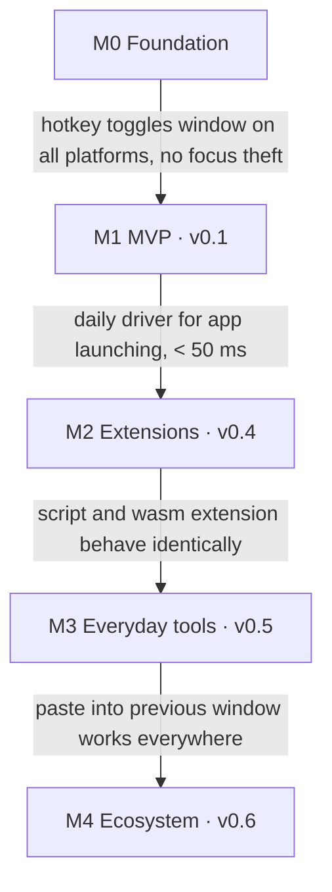

# Daimos — Product Spec

> Working name: **Daimos**. The final name is an open decision (see below).

Daimos is a cross-platform command palette for the desktop — "Raycast for Linux, Windows, and
macOS". One hotkey opens a window that finds applications, files, clipboard entries, and commands
from extensions, with the same extensions and the same keyboard behavior on all three platforms. It
is built with Tauri 2, a Rust core, and a SolidJS frontend.

## Audience

- Developers and power users on Linux who want a Raycast-class daimos, including on Wayland.
- People who work on more than one operating system and want one daimos, one set of extensions,
  and one muscle memory everywhere.
- Extension authors who want to write a command once, in the language of their choice, and ship it
  to all three platforms.

## Positioning

- **Raycast** is macOS-first (Windows in beta), closed source, and its extension API is
  TypeScript/React only. Daimos is open source, Linux-first in effort, and runs extensions as
  scripts or WebAssembly components.
- **Alfred** and **Spotlight** are macOS only. **PowerToys Run** and **Flow Daimos** are Windows
  only. **Udaimos**, **Albert**, **Vicinae**, and **rofi** are Linux only, and most of them
  struggle on Wayland.
- Differentiators: first-class Wayland support, one extension format for three platforms with a
  sandbox the user can see, and a start-up budget that is treated as a feature.

## Principles

- **Latency is the product**: hotkey to visible window under 50 ms warm, first results in the same
  frame. Every feature is measured against this budget before it ships.
- **Rust owns the machine**: indexing, matching, clipboard, hotkeys, and extension processes live in
  the Rust core. The webview only renders.
- **Never steal focus for nothing**: the window shows without taking activation away from the
  previous app (macOS panel semantics), so actions that paste or act on "the current window" work.
- **Extensions are sandboxed by default**: WebAssembly extensions declare the capabilities they need
  (filesystem paths, network hosts, clipboard) and get nothing else. Script extensions run with the
  user's rights and are labeled as such.
- **Local first**: index, history, and settings live on the machine. No account, no telemetry.
- **Same behavior everywhere**: platform differences are hidden in the Rust core; the UI, keyboard
  model, and extension API are identical on all three platforms.

## Feature scope

| Feature              | Milestone       | Scope                                                                                                                        |
| -------------------- | --------------- | ---------------------------------------------------------------------------------------------------------------------------- |
| Hotkey and window    | M0              | Global hotkey on X11, Wayland (portal + compositor fallback), Windows, macOS; show/hide without focus theft; tray; autostart |
| Application daimos   | M1 (v0.1)       | Index of installed apps with icons on all three platforms; fuzzy search; frecency ranking; open, reveal, copy path           |
| Calculator and units | M1 (v0.1)       | Inline math, unit and currency conversion, copy result                                                                       |
| Settings             | M1 (v0.1)       | Hotkey, theme, search providers on/off, per-command aliases                                                                  |
| Extension runtime    | M2 (v0.4)       | Script protocol (JSON Lines over stdio) and WebAssembly components (wasmtime); manifest; capability prompts; hot reload      |
| Extension examples   | M2 (v0.4)       | The same example extension in Bash, Python, Rust (wasm), and JavaScript (wasm) with identical behavior                       |
| Clipboard history    | M3 (v0.2, v0.3) | Text and images, search, pin, paste into the previous window                                                                 |
| Snippets             | M3 (v0.5)       | Text expansions with placeholders, paste into the previous window                                                            |
| File search          | M3 (v0.5)       | Indexed home directory with ignore rules; open, reveal, quick look                                                           |
| Window switcher      | M3 (v0.5)       | List and focus open windows where the platform allows it                                                                     |
| System commands      | M3 (v0.5)       | Lock, sleep, empty trash, toggle dark mode, volume                                                                           |
| Extension catalog    | M4 (v0.6)       | Git-based catalog, install/update from the UI, signed wasm components                                                        |
| MCP bridge           | M4 (v0.6)       | Tools and prompts of configured MCP servers as commands                                                                      |
| AI commands          | M4 (v0.6)       | Optional, BYOK: ask, rewrite selection, summarize clipboard                                                                  |

The MVP covers the core loop: hotkey, type, launch an app, and do it faster than the OS daimos on
all three platforms. Extensions come second, once the window and latency budget are solid, because
every extension is judged against that budget.

## Status

Planning. No code yet.

## Epics

1. Foundation, hotkey, and window
2. Indexing and search
3. Extension runtime (script and wasm)
4. Everyday tools (clipboard, snippets, files, windows, system)
5. Catalog, MCP bridge, and AI
6. Quality, packaging, and release

## Milestones

Each milestone ends at a gate: a demo scenario on all three platforms, not a feature count. The next
milestone starts only once the gate passes. "All three platforms" means Linux on X11, Linux on
Wayland (KDE Plasma and GNOME), Windows 11, and macOS.

| Milestone                            | Scope                                                                                                                                                                          | Gate                                                                                                                                          |
| ------------------------------------ | ------------------------------------------------------------------------------------------------------------------------------------------------------------------------------ | --------------------------------------------------------------------------------------------------------------------------------------------- |
| M0 Foundation                        | Scaffold (Tauri 2, SolidJS, pnpm, Vitest, Cargo workspace, CI matrix); spikes: global hotkey incl. XDG portal, NSPanel on macOS, foreground on Windows, layer-shell on Wayland | The hotkey toggles the window on all three platforms; on macOS the previous app keeps focus; on KDE and GNOME Wayland without an X11 fallback |
| M1 MVP (v0.1)                        | App index with icons, fuzzy matcher, frecency, actions, calculator, settings, tray, autostart, performance harness                                                             | Daily-driver replacement for Spotlight, PowerToys Run, and the GNOME/KDE daimos for launching apps; hotkey to window under 50 ms warm         |
| M2 Extensions (v0.4)                 | Script protocol, wasm runtime with WIT interface, manifest, capability prompts, extension directory, hot reload, example extensions, authoring docs                            | One example extension written as a script and as a wasm component behaves identically on all three platforms                                  |
| M3 Everyday tools (v0.2, v0.3, v0.5) | Clipboard history, snippets, file search, window switcher, system commands, emoji                                                                                              | Paste from clipboard history into the previous window works on all three platforms, including Wayland                                         |
| M4 Ecosystem (v0.6)                  | Extension catalog, MCP bridge, optional AI commands                                                                                                                            | An extension is installed from the catalog and an MCP tool runs as a command                                                                  |
| v1.0                                 | Signed builds (dmg, msi, deb, rpm, AppImage, Flatpak), auto-update, docs site                                                                                                  | —                                                                                                                                             |

## Performance budget

| Path                                  | Budget   | How it is measured                                                          |
| ------------------------------------- | -------- | --------------------------------------------------------------------------- |
| Hotkey to window visible (warm)       | < 50 ms  | Timestamp in the hotkey handler to first paint event                        |
| Keystroke to results (apps, 2k items) | < 16 ms  | Benchmark in `daimos-core`, CI regression check                             |
| Process cold start to hotkey ready    | < 500 ms | Process start to hotkey registration                                        |
| Memory, idle (app + web view)         | < 150 MB | PSS on Linux, footprint on macOS, private working set on Windows; never RSS |
| Wasm extension call                   | < 5 ms   | Benchmark against the example extension                                     |
| Script extension call (warm process)  | < 30 ms  | Benchmark in `daimos-ext` with the Python fixture, CI regression check      |

The budget is enforced from M1 with a benchmark harness; a feature that breaks it does not ship.

## Risks

| Risk                                          | Impact                                                 | Mitigation                                                                                                                                                          |
| --------------------------------------------- | ------------------------------------------------------ | ------------------------------------------------------------------------------------------------------------------------------------------------------------------- |
| No global hotkeys on Wayland without a portal | The core interaction does not work on some compositors | XDG GlobalShortcuts portal (KDE, GNOME 48+, Hyprland) first; `daimos toggle` CLI over a local socket as the fallback for Sway and others; documented per compositor |
| Window placement on Wayland                   | Window appears in the wrong place or behind others     | `gtk-layer-shell` where supported (wlroots, KDE); plain toplevel on GNOME, which centers new windows                                                                |
| Focus theft on macOS                          | Paste and "act on the current app" break               | Non-activating `NSPanel` via `tauri-nspanel`; verified in the M0 spike                                                                                              |
| Foreground restrictions on Windows            | Window opens behind the active app                     | The process that handles the registered hotkey may take the foreground; `WS_EX_TOOLWINDOW` window; verified in the M0 spike                                         |
| Webview start-up time                         | First open after boot is slow                          | The process creates the window at start and only hides and shows it; the webview stays warm                                                                         |
| Script extensions are slow per call           | Typing feels laggy                                     | Long-running mode in the protocol (the process stays alive and receives queries as JSON Lines); debounce; results stream                                            |
| Wasm toolchains for extension authors         | Authoring is harder than a script                      | Scripts stay first-class for simple commands; templates for Rust, JavaScript, and Python components; `daimos ext new`                                               |
| Three platforms at once                       | Test and release effort                                | CI matrix from M0, including a Wayland session in CI (headless `sway` or `weston`); signing from v1.0                                                               |
| Raycast compatibility expectations            | Users expect Raycast extensions to work                | Out of scope; the data model (items, actions, details, forms) is deliberately close so ports are mechanical                                                         |

## Decisions

- **Stack**: Tauri 2, Rust core, SolidJS frontend
  ([ADR 0001](../adr/0001-stack-and-architecture.md)).
- **Extension model**: two runtimes, one data model. Scripts speak JSON Lines over stdio; compiled
  extensions are WebAssembly components run by wasmtime with declared capabilities
  ([ADR 0002](../adr/0002-extension-model.md)).
- **Wayland from day 1**: the portal plus a compositor fallback is part of M0, not a later port
  ([ADR 0003](../adr/0003-wayland-first.md)).
- **Frontend**: SolidJS instead of Angular, for start-up time and bundle size
  ([ADR 0001](../adr/0001-stack-and-architecture.md)).
- **One resident process**: the Tauri process holds the index and hotkey and hides or shows its
  window; a separate `daimos` CLI talks to it over a local socket.
- **Platforms**: Linux, Windows, and macOS together from M0; nothing ships that works on two.

### Open

- **Name**: "Daimos" is a placeholder.
- **License**: open source; `MIT OR Apache-2.0` as in MCP Studio, or a copyleft license to keep
  forks open. Decide before the first public commit.
- **Extension signing**: who signs catalog entries, and whether unsigned extensions install with a
  warning or not at all.

## Related documents

- [Architecture](architecture.md)
- [Extensions](extensions.md)
- [ADR 0001 — Stack and architecture](../adr/0001-stack-and-architecture.md)
- [ADR 0002 — Extension model](../adr/0002-extension-model.md)
- [ADR 0003 — Wayland first](../adr/0003-wayland-first.md)
